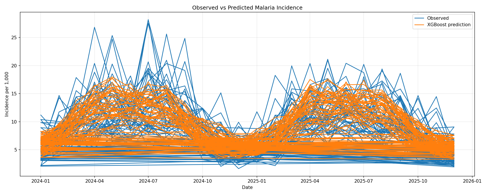
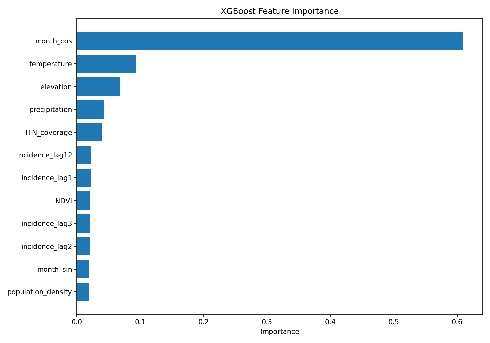
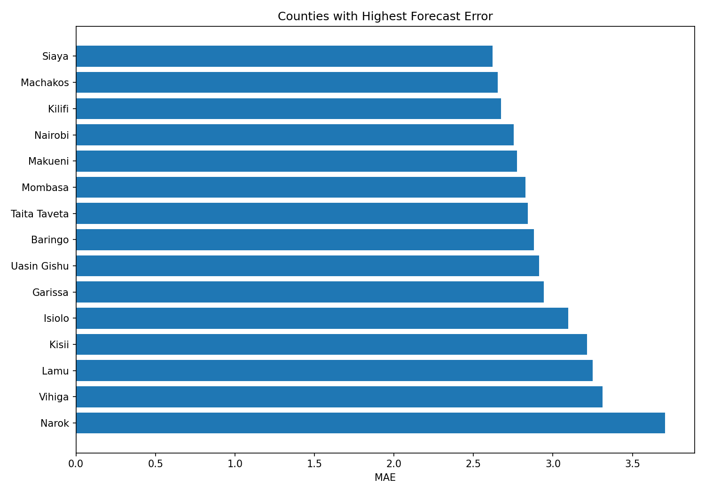

# Malaria Monthly Incidence Forecasting in Kenya

This project develops an end-to-end Machine Learning pipeline using **XGBoost Regressor** to predict monthly malaria incidence (per 1,000 population) across 47 counties in Kenya. 

## 1. Project Background & Objective
Malaria remains a major public health challenge in Kenya. Accurate forecasts at the county level allow health authorities to optimally distribute medical supplies and coordinate preventive interventions (such as Insecticide-Treated Nets - ITNs).

## 2. Dataset & Features
The modeling dataset spans from **2015 to 2025** across **47 unique Kenyan counties**, incorporating:
* **Target**: `incidence_per_1000`
* **Predictor Features**:
  * **Malaria History (Lags)**: Lags of 1, 2, 3, and 12 months (`incidence_lag1`, `incidence_lag2`, `incidence_lag3`, `incidence_lag12`)
  * **Environmental Dynamics**: Monthly temperature, precipitation, and NDVI (vegetation greenness index)
  * **Public Health Interventions**: ITN coverage
  * **Spatial Context**: Elevation and population density
  * **Temporal Seasonality**: Sinusoidal and cosinusoidal month encodings (`month_sin`, `month_cos`)

## 3. Train-Validation-Test Experimental Setup
To ensure temporal validation without leaking future lookahead data into the training phase, we established a strict chronological split:
* **Training Set**: 2015 – 2021 (3,290 samples)
* **Validation Set**: 2022 – 2023 (1,128 samples)
* **Test Set**: 2024 – 2025 (1,128 samples)

## 4. Evaluation Metrics & Benchmark Performance
We evaluated our tuned **XGBoost Regressor** against a **Seasonal Baseline** (which predicts the current month's incidence using the historical 12-month lag value):

| Model | Mean Absolute Error (MAE) | Root Mean Squared Error (RMSE) | Coefficient of Determination ($R^2$) |
| :--- | :---: | :---: | :---: |
| **Seasonal Baseline** | 3.1089 | 4.2346 | 0.0008 |
| **XGBoost Regressor** | **2.3587** | **3.1038** | **0.4632** |

### Forecast Visualization
Below is the comparison chart of the actual observed malaria incidence and the model predictions on the 2024-2025 test dataset:

## 5. Feature Importance Analysis
The feature importance analysis highlights what drives malaria incidence predictions:
* **Seasonality (`month_cos`)** is the dominant predictor with over **60% of total importance**, signaling highly cyclical transmission windows.
* **Temperature** and **Elevation** follow as key environmental constraints that dictate mosquito habitat feasibility.

## 6. County-Level Error Profile
Model performance varies across different geographies:
* **Lowest Error Counties**: Kajiado (MAE: 1.348) and Tharaka-Nithi (MAE: 1.549).
* **Highest Error Counties**: Narok (MAE: 3.705), Vihiga (MAE: 3.311), and Lamu (MAE: 3.249).

*Recommendation*: Future modeling attempts should cluster counties into regional transmission zones or utilize localized spatial-temporal models to address high-incidence hotspots.

---
### Output Artifacts Available in Workspace:
1. `malaria_xgboost_model.joblib`: Serialized ready-to-deploy trained XGBoost model.
2. `malaria_forecast_test_results.csv`: Out-of-sample predictions on the 2024-2025 test split.
3. `model_metadata.json`: Full model configurations and structural settings.
4. Visualizations: `forecast_vs_observed.png`, `feature_importance.png`, and `county_errors.png`.
